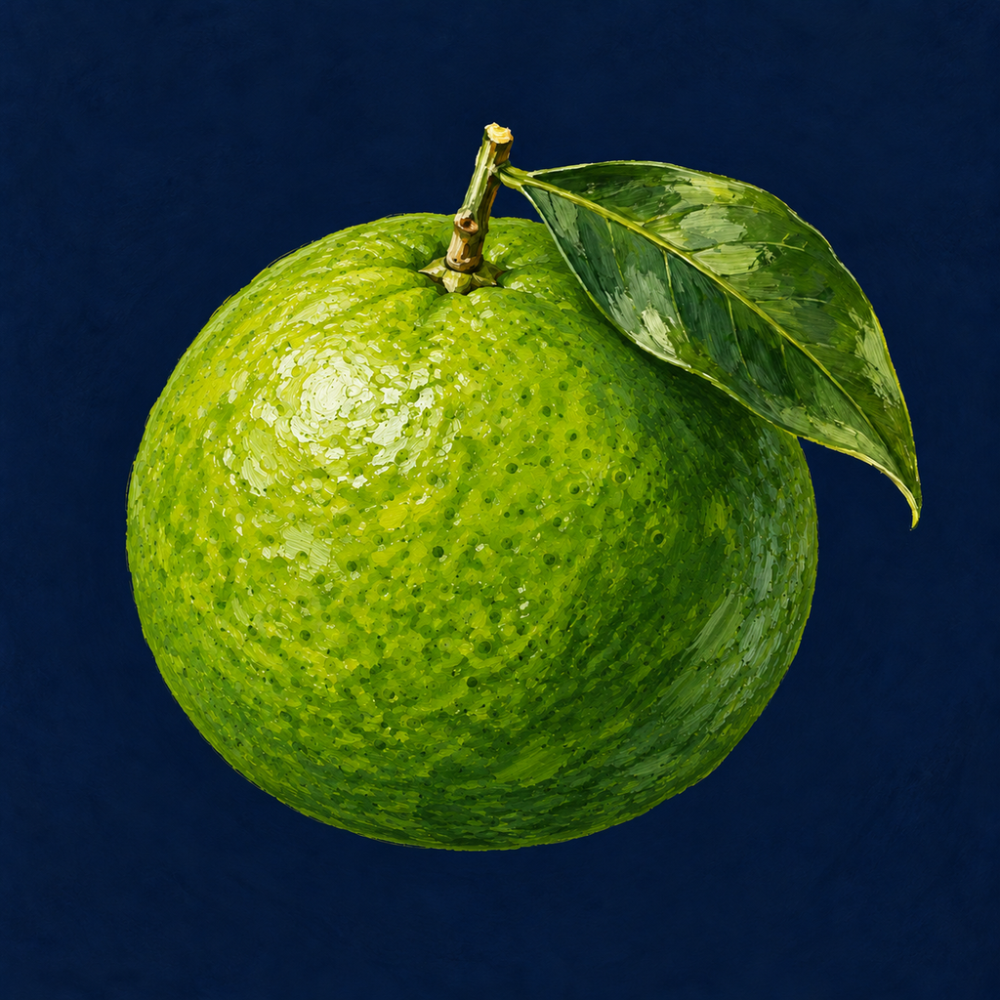

<p align="center"></p>
<h1 align="center">Kabosu</h1>
<p align="center">Десктопный клиент Citrus: профили, правила маршрутизации и соединения в одном приложении.<br />Windows · macOS · Linux</p>
<p align="center"><a href="../README.md">English</a> · <a href="README_zh.md">简体中文</a> · <a href="https://github.com/getmikan/Kabosu/releases">Скачать</a> · <a href="https://github.com/getmikan/Kabosu/issues">Сообщить об ошибке</a></p>

## О проекте

**Kabosu** — форк [Sloth Clash](https://github.com/Nemu-x/SlothClash), который поддерживает [getmikan](https://github.com/getmikan). В основе — ядро [Citrus](https://github.com/getmikan/Citrus), оболочка Go/Wails и интерфейс React/TypeScript. У форка собственное название, иконка с кабосу и ссылки на релизы.

Для подключения нужна своя подписка, ссылки на серверы или локальный YAML-конфиг. Приложение не предоставляет серверы и не продаёт VPN-подписку.

## Возможности

- Подписки, ссылки на серверы и локальные профили YAML.
- Выбор узлов и групп прокси, проверка задержки и обновление подписок.
- Системный прокси и режим TUN.
- Мониторинг соединений, трафика, правил и журналов.
- Визуальный и YAML-редактор правил, merge-конфиги и JavaScript-обработчики профилей.
- Русский, английский и китайский интерфейс, светлая и тёмная темы.
- Иконки трея с отдельными состояниями отключения, Proxy и TUN.
- Импорт через `kabosu://install-config` с подтверждением пользователя.
- Проверка релизов `getmikan/Kabosu`; установка обновлений Windows требует подписанных контрольных сумм.

Интерфейс — зелёный Material 3 Expressive, локальный Roboto Flex и официальные Material Symbols. REALITY, provider overrides и групповые проверки выполняет Citrus. При переносе старых профилей прочитайте [заметки о совместимости ядра](../core/citrus/README.md).

Заголовки панели совместимы с MikanApp: оформление, личный кабинет, политики и квоты групп. [Справочник заголовков](PANEL_HEADERS_ru.md).

## Скачать

Сборки публикуются в [релизах Kabosu](https://github.com/getmikan/Kabosu/releases). Если для нужной платформы нет файла, приложение можно собрать из исходников.

| Система | Форматы сборки |
| --- | --- |
| Windows x64 / ARM64 | Установщик `Kabosu-windows-<arch>-installer.exe` |
| macOS Apple Silicon / Intel | `Kabosu-macOS-<arch>.dmg` |
| Linux x64 / ARM64 | AppImage, deb, rpm, пакет Arch, tar.gz |

Для TUN требуется привилегированный helper: установите его через настройки. В Linux для tar.gz нужны GTK 3 и WebKitGTK 4.1, в AppImage они включены. Windows использует WebView2. Бинарники helper пока берутся из [исходного проекта сервиса](https://github.com/Nemu-x/sloth-clash-service-ipc).

## Сборка

Нужны **Go 1.26.7**, **Node.js 20.19+ или 22.12+**, **pnpm 10.33.0** и [системные зависимости Wails](https://wails.io/docs/gettingstarted/installation). Для установщика Windows нужен NSIS, для Linux — пакеты разработки GTK/WebKit. Скрипты найдут или установят Wails v2 CLI.

```bash
git clone https://github.com/getmikan/Kabosu.git
cd Kabosu
pnpm install --frozen-lockfile
pnpm run desktop:resources
pnpm run wails:dev
```

`desktop:resources` запускает обязательные проверки и готовит ядро, сервис и иконки. Для загрузки ресурсов нужен интернет. Команда сборки текущей платформы — `pnpm run wails:build`. Команды установщиков и сборок других платформ перечислены в [основном README](../README.md#build-from-source).

Исходники находятся в `apps/sloth-clash-desktop`. Это внутреннее имя унаследовано от исходного проекта; приложение и пакеты называются Kabosu. Каталог профилей, IPC и имена внешнего сервиса сохранены для совместимости. Подробнее — [BRANDING.md](BRANDING.md).

## Иконки

Основное изображение — [`appicon-main.png`](appicon-main.png). Оно используется в README, интерфейсе, системных иконках и цветном трее. Монохромный трей использует силуэт того же плода с листом.

```bash
pnpm run copy:desktop-appicon
pnpm run icons:windows
pnpm run desktop:packaging
```

## Проверки и обновления

Обязательные проверки: `pnpm run test:required`. Проверка интерфейса: `pnpm run lint`. Сборки платформ выполняет [Desktop artifacts](../.github/workflows/desktop-artifacts.yml).

Перед выпуском собственных подписанных обновлений настройте ключ minisign Kabosu и секреты репозитория по [UPDATES.md](UPDATES.md). В коде пока сохранён открытый ключ исходного проекта; он не становится ключом Kabosu от смены названия. Проверка подписи действует: неподписанные или подписанные другим ключом обновления Windows будут отклонены. Для SignPath, winget, AUR и Pages нужна отдельная настройка форка.

## Участие, безопасность и лицензия

Правила разработки — [CONTRIBUTING.md](../CONTRIBUTING.md), сообщения об уязвимостях — [SECURITY.md](../SECURITY.md).

Спасибо **Nemu-x и участникам Sloth Clash**, а также проектам [Clash Verge Rev](https://github.com/clash-verge-rev/clash-verge-rev), [Clash Verge](https://github.com/zzzgydi/clash-verge), [Mihomo](https://github.com/MetaCubeX/mihomo) и [Wails](https://github.com/wailsapp/wails).

Исходная лицензия и история проекта сохранены. Лицензия Kabosu — [GPL-3.0-only](../LICENSE).
